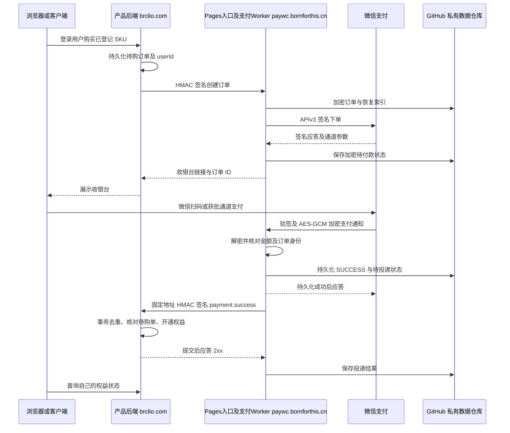

# 架构与运行边界

## 信任边界

业务端只信任自己的登录态和持久化待购订单。支付中心只允许产品服务端用独立密钥下单和查询；CORS、返回域名和前端状态不是调用授权。商品价格由服务端目录控制。Webhook 接收地址是预登记的固定 HTTPS 地址，不能由用户传入或跟随重定向，防止回调被转发到其他服务。

公网子域名先到 Pages Advanced mode 网关，再通过 Service binding 调用核心 Worker。网关转发原始请求且不持有商户秘密；核心 Worker 保留静态资源绑定与计划任务。阿里云保留权威 DNS，Pages 自定义子域名使用 CNAME。新增管理后台通过邮箱/密码、2 小时签名 Cookie、同源/CSRF 校验和登录限流保护；管理员可以在关闭真实付款时配置接入产品。

支付中心对微信下单、查询结果和通知执行 RSA/SHA-256 验签，按可信公钥 ID 选择固定公钥，再解密通知并核对订单号、商户号、AppID、金额、CNY 币种及成功交易流水。`SUCCESS` 状态不被迟到的未付款消息回退。密钥不足、收款开关未启用或支付通道未批准时拒绝真实下单。[微信 APIv3 安全规则](https://pay.wechatpay.cn/doc/v3/merchant/4012365342)

Cloudflare Workers WebCrypto 支持 SHA-256、RSASSA-PKCS1-v1_5 与 AES-GCM，本项目无需在 Worker 中运行 Java SDK、OpenSSL 子进程或 Node 文件系统。[Cloudflare Web Crypto](https://developers.cloudflare.com/workers/runtime-apis/web-crypto/)

## 订单、幂等与恢复

支付订单号由稳定 `ORDER_ID_SECRET` 对 `clientId + merchantOrderId` 派生，原始业务订单号不出现在 GitHub 文件路径。订单保存不可变请求摘要；业务订单号被不同请求复用时返回冲突。微信下单前先持久化恢复索引，因此微信返回成功后网络中断时可重试查询同一个订单。

支付中心为每笔成功订单生成稳定事件 ID `payment.success.<orderId>`；投递失败会使用同一事件 ID 重试，时间戳及 nonce 每次更新。业务端必须通过事务和唯一约束完成去重与权益开通。并发租约与 GitHub SHA 校验减少重复工作，但网络超时、崩溃与租约过期仍可能产生重复投递；系统不承诺“恰好一次”回调。

默认计划任务每 10 分钟处理最多 10 条工作索引，补充查单、关单和通知重试。批处理有边界，流量增长会增加延迟。Webhook 多次失败后进入人工处理状态，不能静默视为已经开通。产品还应定时扫描自身待购订单，通过签名查询/刷新接口对账。微信官方也要求结合查询接口，不能只依赖回调。[支付通知与重试](https://pay.wechatpay.cn/doc/v3/merchant/4012791861)

接收微信通知需在 5 秒内应答。本实现先完成必要的持久化才成功应答；GitHub 写入超时/失败时让通知失败重试，再用查单补偿。仅放到 `waitUntil` 后立即确认成功，无法保证后台任务失败时数据不丢。

## GitHub 数据存储

固定仓库：`BrclioData/Brclio-WeChatPay-Data`，必须为私有。订单在 `orders/`，待处理工作索引在 `work/`，后台产品登记在 `config/clients.json`；内容均使用 AES-256-GCM 加密，随机 IV，仓库名和路径绑定附加认证数据。GitHub 保存可见的文件路径、提交时间和密文长度；私有仓库与加密不隐藏这些元数据。产品 API/Webhook 密钥只以加密形式随产品配置保存；仓库不保存商户私钥、APIv3 密钥或数据加密密钥。

GitHub 是有并发冲突和限流的文件/提交 API，适合当前低交易量阶段，不能按数据库的吞吐与事务假设使用。更新携带原文件 SHA，冲突时重新读取、合并并限制重试；单个订单的成功状态与投递状态在同一记录中更新，业务跨系统事务由幂等协议实现。[GitHub Contents API](https://docs.github.com/en/rest/repos/contents)

常见 PAT 主额度为 5,000 次请求/小时；一般内容创建还受 80 次/分钟、500 次/小时等次级限制，额度可能共享且随平台规则变化。每笔订单会产生多次写入和提交，不能将“500 次写入”当作“500 笔支付”额度。连续轮询也消耗读取额度。应关注响应中的限流/重试 Header，并在受限时停止密集重试。[GitHub 限流](https://docs.github.com/en/rest/using-the-rest-api/rate-limits-for-the-rest-api)

GitHub 建议串行请求、大量变更请求之间至少间隔 1 秒。任何单个 Worker 进程的锁都不能序列化全球实例，所以应用仍需依靠远端 SHA 冲突检测和重试；高并发下不能保证实时收款体验。[GitHub API 调用建议](https://docs.github.com/en/rest/using-the-rest-api/best-practices-for-using-the-rest-api)

发生限流或仓库故障时，不应伪造付款成功或提前开通。应提示状态确认中，保留待处理记录，使用微信通知重试、产品签名查单和后续人工对账恢复。未来若要扩大规模，应先重新评估存储能力，任何更换存储或新增付费资源都需另行决定。

## 密钥、备份与数据保留

`ENCRYPTION_KEY` 必须安全离线备份。丢失后无法解密历史订单；直接替换会使现有订单不可读。当前未实现多版本数据密钥迁移，所以不能通过简单覆盖值进行生产轮换。`ORDER_ID_SECRET` 也需稳定保留，否则同业务订单派生不同支付 ID；轮换前需有历史查询和迁移设计。`CHECKOUT_SECRET` 变更会使原收银台链接失效。产品 API/Webhook 密钥变更需协调未完成订单和通知，当前没有双密钥自动过渡协议。

订单和付款记录默认保留，不按浏览器过期时间删除。完成的工作索引可以移除，永久订单仍用于查询、对账和去重。Git 历史会保留删除前的密文与提交；删除当前文件并不清除历史。保留期限、仓库访问者、备份和历史清理需要商家按实际业务制定，不能声称“已彻底删除”。GitHub、Cloudflare 账户及密钥应按最小范围授权；Cloudflare 运行与 GitHub 平台仍各自存在套餐及使用限制。
